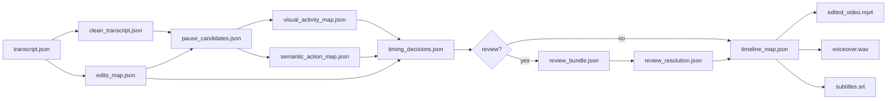

# JSON-контракты между этапами pipeline

> Все артефакты наследуют общие поля — см. раздел «Базовый envelope».

---

## Базовый envelope (все JSON-артефакты)

```json
{
  "job_id": "job_20260616_001",
  "stage": "transcription",
  "version": "1.0.0",
  "created_at": "2026-06-16T12:00:00Z",
  "source_artifacts": ["input_manifest.json", "raw_video.mp4"],
  "status": "completed",
  "confidence_summary": 0.94,
  "warnings": [],
  "errors": []
}
```

| Поле | Тип | Описание |
|------|-----|----------|
| `job_id` | string | Уникальный ID задачи |
| `stage` | string | Имя этапа (enum) |
| `version` | string | Версия схемы |
| `created_at` | ISO 8601 | Время создания |
| `source_artifacts` | string[] | Входные файлы |
| `status` | enum | `pending` \| `running` \| `completed` \| `failed` \| `needs_review` |
| `confidence_summary` | float 0–1 | Сводная уверенность этапа |
| `warnings` | string[] | Некритичные проблемы |
| `errors` | string[] | Критичные ошибки |

---

## 1. transcript.json

**Этап:** Speech Recognition (Stage 1)  
**Вход:** `raw_video.mp4`  
**Выход:** текст + таймкоды

```json
{
  "job_id": "job_001",
  "stage": "transcription",
  "version": "1.0.0",
  "created_at": "2026-06-16T12:05:00Z",
  "source_artifacts": ["raw_video.mp4"],
  "status": "completed",
  "confidence_summary": 0.91,
  "warnings": [],
  "errors": [],
  "language": "ru",
  "duration_seconds": 420.5,
  "segments": [
    {
      "segment_id": "seg_001",
      "start": 0.0,
      "end": 4.32,
      "text": "Сегодня мы разберём проведение счёта-фактуры в 1С.",
      "confidence": 0.95,
      "words": [
        {
          "word": "Сегодня",
          "start": 0.0,
          "end": 0.48,
          "confidence": 0.98
        }
      ]
    }
  ]
}
```

**Инварианты:**
- `segments[].start` монотонно не убывает;
- `start < end` для каждого сегмента и слова;
- `segment_id` уникален в рамках job.

---

## 2. edits_map.json

**Этап:** Speech Cleanup (Stage 2)  
**Вход:** `transcript.json`  
**Выход:** карта предложенных правок текста

```json
{
  "job_id": "job_001",
  "stage": "speech_cleanup",
  "version": "1.0.0",
  "created_at": "2026-06-16T12:10:00Z",
  "source_artifacts": ["transcript.json"],
  "status": "completed",
  "confidence_summary": 0.88,
  "warnings": [],
  "errors": [],
  "edits": [
    {
      "edit_id": "edit_001",
      "segment_ids": ["seg_003"],
      "source_start": 12.4,
      "source_end": 14.1,
      "problem_type": "filler_word",
      "original_text": "э-э-э, ну,",
      "proposed_action": "remove",
      "proposed_text": "",
      "confidence": 0.96,
      "explanation": "Слова-паразиты без смысловой нагрузки",
      "risk_level": "low"
    },
    {
      "edit_id": "edit_002",
      "segment_ids": ["seg_007", "seg_008"],
      "source_start": 45.0,
      "source_end": 52.3,
      "problem_type": "self_correction",
      "original_text": "открываем... нет, переходим в раздел",
      "proposed_action": "replace",
      "proposed_text": "переходим в раздел",
      "confidence": 0.82,
      "explanation": "Ложный старт, исправленная формулировка сохранена",
      "risk_level": "medium"
    }
  ]
}
```

**Enums:**

| `problem_type` | Описание |
|----------------|----------|
| `filler_word` | Э-э, ну, вот |
| `self_correction` | Самопоправка |
| `repetition` | Повтор фразы |
| `long_pause` | Длинная пауза в речи |
| `false_start` | Начало фразы без продолжения |
| `irrelevant` | Off-topic вставка |

| `proposed_action` | Описание |
|-------------------|----------|
| `remove` | Удалить |
| `replace` | Заменить текст |
| `trim` | Сократить |
| `keep` | Оставить |

| `risk_level` | `low` \| `medium` \| `high` |

---

## 3. timing_decisions.json

**Этап:** Timing Decision — Policy (Stage 2B, шаг 4)  
**Вход:** pause_candidates, visual_activity_map, semantic_action_map, edits_map

```json
{
  "job_id": "job_001",
  "stage": "timing_policy",
  "version": "1.0.0",
  "created_at": "2026-06-16T12:20:00Z",
  "source_artifacts": [
    "pause_candidates.json",
    "visual_activity_map.json",
    "semantic_action_map.json",
    "edits_map.json"
  ],
  "status": "needs_review",
  "confidence_summary": 0.85,
  "warnings": ["2 intervals flagged for human review"],
  "errors": [],
  "decisions": [
    {
      "candidate_id": "cand_001",
      "decision": "remove_audio_video",
      "target_start": 82.12,
      "target_end": 87.34,
      "confidence": 0.93,
      "risk_level": "low",
      "routing": "auto_approve",
      "why": "long pause with no meaningful screen change",
      "requires_review": false,
      "evidence": {
        "visual_event_type": "no_meaningful_change",
        "instruction_relation": "between_actions",
        "critical_for_learning": false
      }
    },
    {
      "candidate_id": "cand_002",
      "decision": "needs_human_review",
      "target_start": 190.20,
      "target_end": 194.60,
      "confidence": 0.61,
      "risk_level": "medium",
      "routing": "required_review",
      "why": "cursor movement appears linked to upcoming action",
      "requires_review": true,
      "evidence": {
        "visual_event_type": "cursor_movement",
        "instruction_relation": "pre_action_transition",
        "critical_for_learning": true
      }
    }
  ]
}
```

**Enums `decision`:**
- `remove_audio_video`
- `trim_soft`
- `speedup_video`
- `keep_as_is`
- `needs_human_review`

**Enums `routing`:**
- `auto_approve`
- `standard_review`
- `required_review`
- `senior_review`

---

## 4. review_bundle.json

**Этап:** Human Review Gate 1 (Timing)  
**Вход:** `timing_decisions.json` (только `requires_review = true`)

```json
{
  "job_id": "job_001",
  "stage": "timing_review_bundle",
  "version": "1.0.0",
  "created_at": "2026-06-16T12:21:00Z",
  "source_artifacts": ["timing_decisions.json"],
  "status": "pending",
  "confidence_summary": null,
  "warnings": [],
  "errors": [],
  "items": [
    {
      "review_id": "rev_001",
      "candidate_id": "cand_002",
      "video_excerpt_start": 187.20,
      "video_excerpt_end": 197.60,
      "proposed_decision": "trim_soft",
      "alternative_decisions": ["keep_as_is", "speedup_video"],
      "confidence": 0.61,
      "routing": "required_review",
      "reason_for_review": "possible mismatch between cursor movement and speech timing",
      "evidence": {
        "visual_event_type": "cursor_movement",
        "instruction_relation": "pre_action_transition",
        "critical_for_learning": true,
        "cursor_motion_score": 0.72,
        "ui_change_score": 0.15
      },
      "context_transcript": "Теперь нажимаем кнопку Создать..."
    }
  ]
}
```

**Ответ человека:** `review_resolution.json`

```json
{
  "job_id": "job_001",
  "stage": "timing_review_resolution",
  "version": "1.0.0",
  "created_at": "2026-06-16T12:45:00Z",
  "source_artifacts": ["review_bundle.json"],
  "status": "completed",
  "resolutions": [
    {
      "review_id": "rev_001",
      "final_decision": "trim_soft",
      "approved_by": "user@example.com",
      "custom_parameters": {
        "trim_seconds": 1.5,
        "speed_factor": null
      }
    }
  ]
}
```

---

## 5. timeline_map.json

**Этап:** Timing Decision — финал (Stage 2B, шаг 7)  
**Назначение:** единый источник истины для монтажа, TTS, субтитров, аннотаций

```json
{
  "job_id": "job_001",
  "stage": "timeline_map",
  "version": "1.0.0",
  "created_at": "2026-06-16T12:50:00Z",
  "source_artifacts": [
    "timing_decisions.json",
    "review_resolution.json"
  ],
  "status": "completed",
  "confidence_summary": 1.0,
  "warnings": [],
  "errors": [],
  "source_duration_seconds": 420.5,
  "target_duration_seconds": 398.2,
  "segments": [
    {
      "segment_index": 0,
      "source_start": 0.0,
      "source_end": 82.12,
      "target_start": 0.0,
      "target_end": 82.12,
      "transform": "keep",
      "speed_factor": 1.0
    },
    {
      "segment_index": 1,
      "source_start": 82.12,
      "source_end": 87.34,
      "target_start": 82.12,
      "target_end": 82.12,
      "transform": "removed",
      "speed_factor": null
    },
    {
      "segment_index": 2,
      "source_start": 190.20,
      "source_end": 194.60,
      "target_start": 185.20,
      "target_end": 187.70,
      "transform": "trim_soft",
      "speed_factor": 1.0,
      "trim_removed_seconds": 1.5
    },
    {
      "segment_index": 3,
      "source_start": 200.0,
      "source_end": 215.0,
      "target_start": 192.70,
      "target_end": 199.70,
      "transform": "speedup_video",
      "speed_factor": 2.0
    }
  ]
}
```

**Enums `transform`:**
- `keep` — без изменений
- `removed` — вырезан полностью
- `trim_soft` — частичное сокращение
- `speedup_video` — ускорение видео (аудио перегенерируется TTS)

**Инварианты:**
- Сегменты покрывают весь source timeline без дыр и перекрытий;
- `target_start`/`target_end` монотонны;
- Сумма target длительностей = `target_duration_seconds`.

---

## Связь контрактов (diagram)



---

## Файлы JSON Schema

Machine-readable схемы лежат в `src/schemas/`:

- `transcript.schema.json`
- `edits_map.schema.json`
- `timing_decisions.schema.json`
- `review_bundle.schema.json`
- `timeline_map.schema.json`
